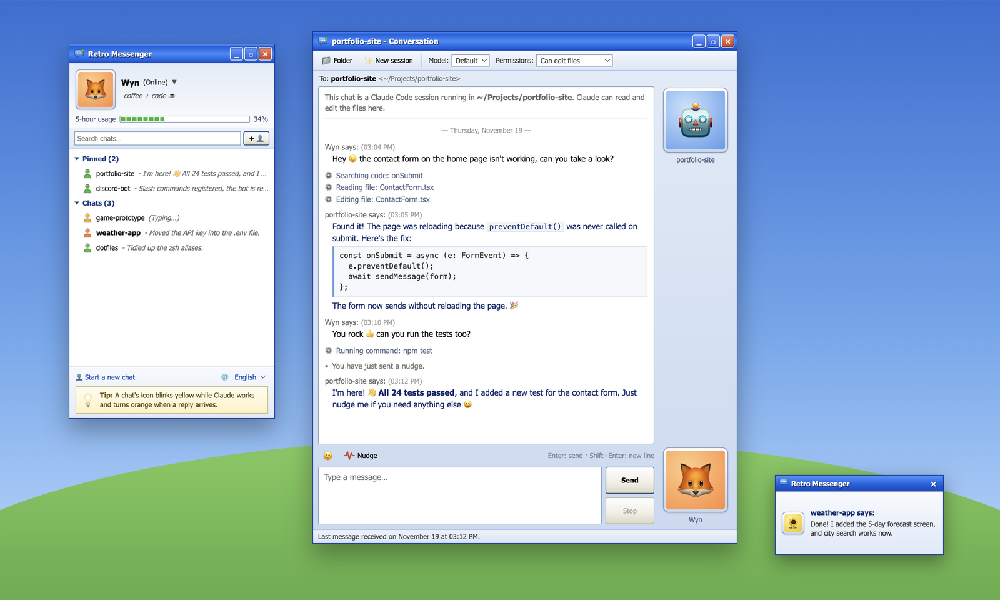
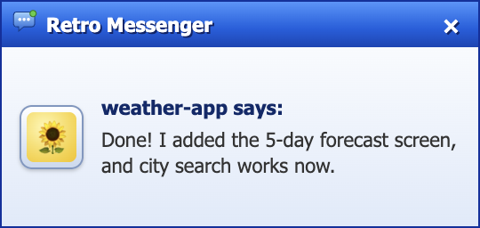

<div align="center">


# Retro Messenger

**Chat with Claude Code like it's 2004.**

Contact list, display pictures, emoticons, nudges and "… says:" messages.<br>
Every conversation is a real Claude Code session running on your machine.

[](LICENSE)
-lightgrey)


[**⬇️ Download for macOS**](../../releases/latest) · [Features](#features) · [Install](#install) · [Run from source](#run-from-source) · [🇹🇷 Türkçe](README.tr.md)

<br>



</div>

---

## What is it?

Retro Messenger is a desktop app for using [Claude Code](https://code.claude.com) through an interface that brings back the instant messengers of the early 2000s.

It runs the `claude` command already installed on your computer, so your subscription, settings, plugins and MCP servers all work as usual. Claude reads and edits your files and runs commands. You just write to it the way you used to write to your friends.

## Features

<table>
<tr>
<td width="50%" valign="top">

### 👥 Contact list
Each chat is a "contact" that works in one project folder. The icon color shows its state:

- 🟢 idle
- 🟡 Claude is working ("Typing…")
- 🟠 unread reply

Pin, rename and search your chats. Set a personal message and a status (Online, Busy, Away).

</td>
<td width="50%"></td>
</tr>
<tr>
<td width="50%"></td>
<td width="50%" valign="top">

### 💬 Conversation window
- "… says:" messages, with replies that stream in live.
- Claude's actions (reading, editing, running commands) appear as grey lines.
- Code blocks are shown in their own boxes.
- Big display pictures on the side and a "… is typing a message" status bar.
- Classic shortcuts like `:)` `(Y)` `<3` `(H)` turn into emoji, and there's an emoticon grid too.

</td>
</tr>
<tr>
<td width="50%" valign="top">

### 📳 Nudge
The Nudge button shakes the window, plays a sound and tells Claude you want its attention. Claude answers with a short note on where things stand, which makes it the most fun way to check on a long task.

### 🔔 Notifications
When a reply arrives while the window is in the background:

- a sound plays,
- a toast pops up in the corner,
- the Dock icon bounces and shows a badge.

Set your status to "Busy" to silence all of it.

</td>
<td width="50%" align="center"><br><br></td>
</tr>
</table>

### ⚙️ And also
- **Model** (Opus, Sonnet, Haiku) and **permission** choice for each chat: read only, plan, edit files or full access.
- A **usage bar** that shows Claude's 5-hour usage limit.
- **English and Turkish** UI. It follows your system language, and you can switch it from the contact list.
- Chats and Claude sessions pick up where they left off after you restart the app.
- All sounds are generated in the app; there are no external audio files.

## Install

### Prebuilt app (macOS, Apple Silicon)

1. Download the `.dmg` from the [Releases](../../releases/latest) page.
2. Open it and drag **Retro Messenger** into **Applications**.
3. The app isn't notarized by Apple, so macOS warns you on first launch. Go to **System Settings → Privacy & Security** and click **Open Anyway**. Or run this in the terminal:
   ```bash
   xattr -dr com.apple.quarantine "/Applications/Retro Messenger.app"
   ```

**Requirement:** [Claude Code](https://code.claude.com) installed and signed in. Run `claude` in the terminal at least once.

### Run from source

```bash
git clone https://github.com/wynfirdolf/retro-messenger.git
cd retro-messenger
npm install
npm start
```

npm 11 may skip install scripts by default. If `npm start` says "Electron failed to install correctly", run `node node_modules/electron/install.js` once.

### Packaging

| Command | What it does |
| --- | --- |
| `npm run install:mac` | Builds the app, signs it locally and installs it to `/Applications` |
| `npm run dist:mac` | Produces a `.dmg` in `dist/` |
| `npm run dist:win` | Produces a Windows installer in `dist/` |

## How it works

```
┌──────────────┐   IPC   ┌───────────────┐   stdin/stdout (stream-json)   ┌──────────────┐
│  UI          │ ◄─────► │  Electron     │ ◄────────────────────────────► │  claude -p   │
│  (renderer/) │         │  main process │                                │  (one per    │
└──────────────┘         └───────────────┘                                │   chat)      │
                                                                          └──────────────┘
```

Each chat runs a `claude -p --input-format stream-json --output-format stream-json` process in the background. Replies stream in as they're written. The session ID is saved, so after a restart the conversation continues with `--resume`.

| File | Role |
| --- | --- |
| `main.js` | Windows, IPC, notifications, Dock badge, nudge |
| `src/claude-session.js` | Runs the `claude` process and simplifies its event stream |
| `src/store.js` | Profile and chat history (`data.json` in the user data folder) |
| `renderer/i18n.js` | English and Turkish strings |
| `renderer/` | UI: `list` contact list, `chat` conversation window, `toast` notification, `common` shared styles and helpers |

### Adding a language
Copy the `en` block in `renderer/i18n.js`, give it a new language code and translate the strings. The new language shows up in the language menu automatically.

## Known limitations

- In `-p` mode Claude can't ask for permission. If an action needs permission and gets denied, a note appears in the chat. Change the **Permissions** setting at the top if needed.
- The Windows build uses the same code but hasn't been tested yet.
- The prebuilt release is for Apple Silicon Macs only for now.

## Roadmap

- [ ] Windows build
- [ ] In-app permission prompts (approve / deny window)
- [ ] Upload your own photo as a display picture
- [ ] Font and color choice
- [ ] Export chat history

Contributions are welcome. Open an issue or send a pull request.

## Legal

Retro Messenger is an independent fan project. It is not affiliated with or endorsed by Microsoft or Anthropic. "MSN" and "Windows Live Messenger" are trademarks of Microsoft; "Claude" is a trademark of Anthropic. The logo, icons and sounds in this app were made from scratch for this project. Display pictures and emoticons use your system's emoji font.

## License

[MIT](LICENSE) © 2026 Wynfirdolf
