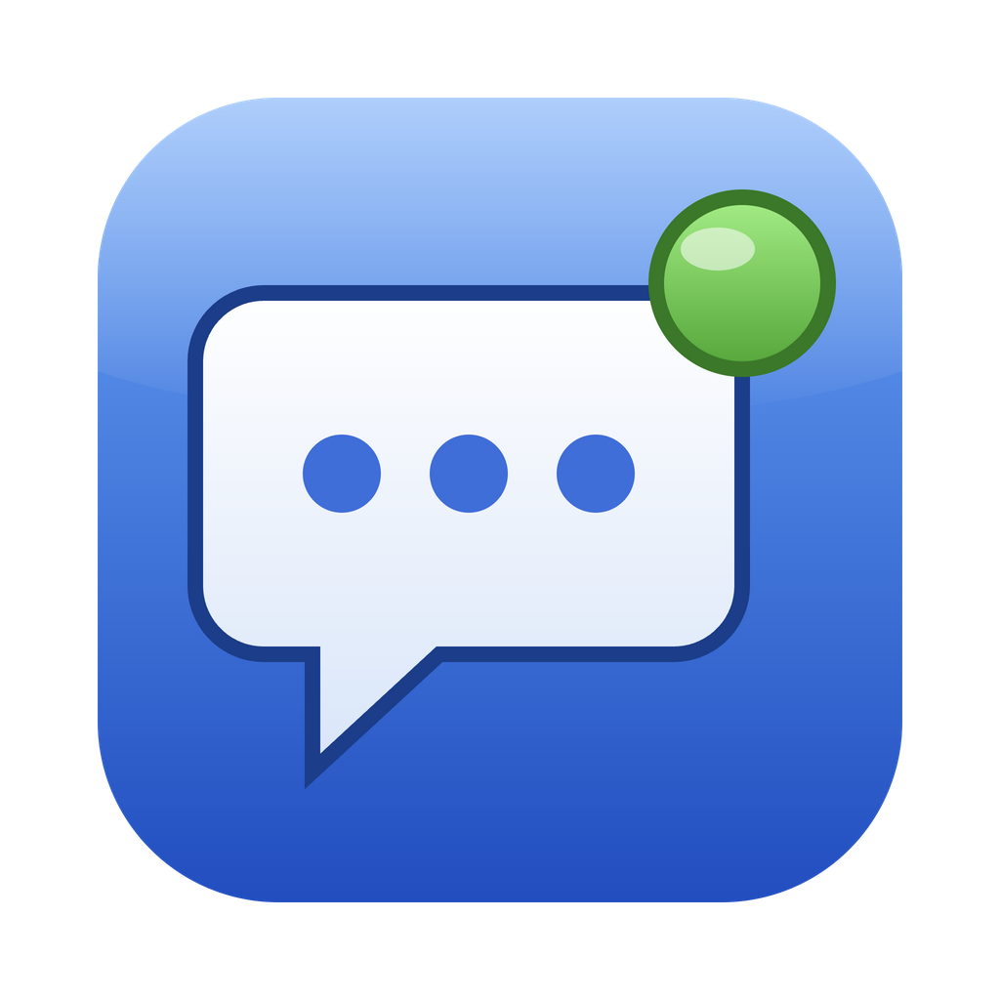
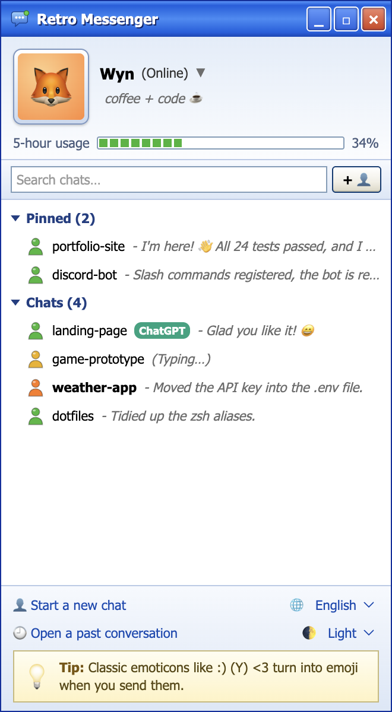
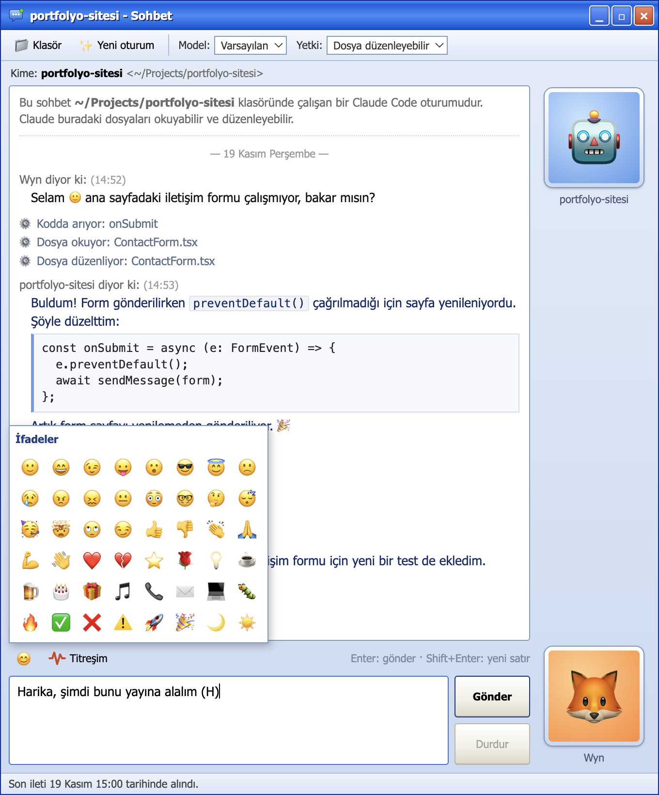
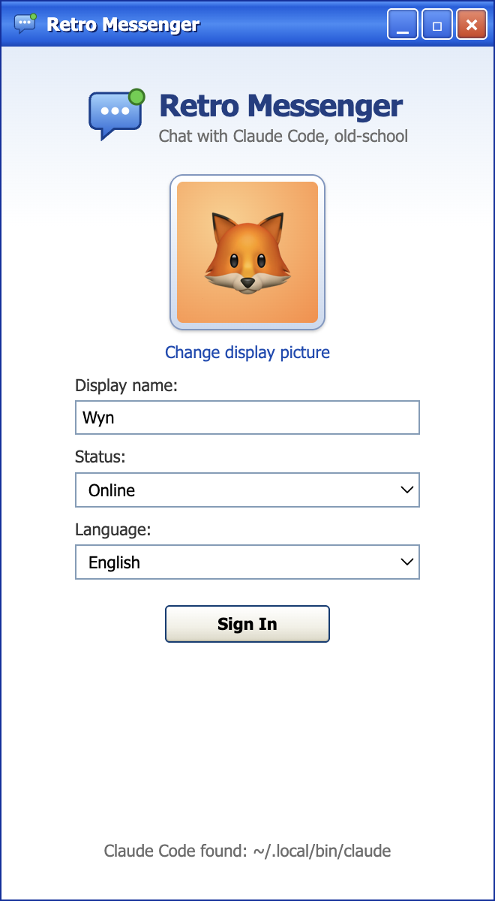
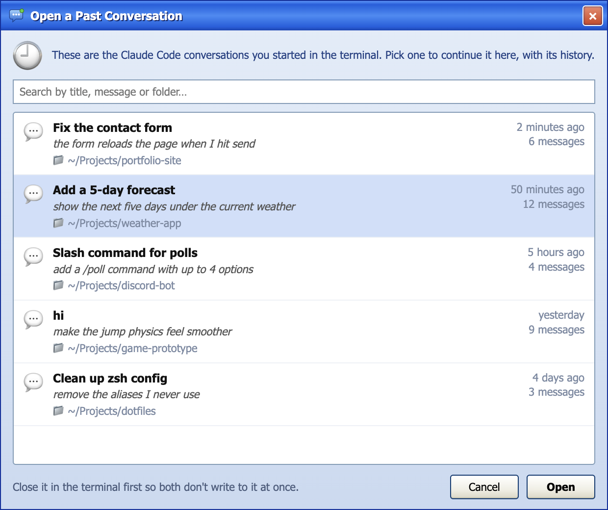
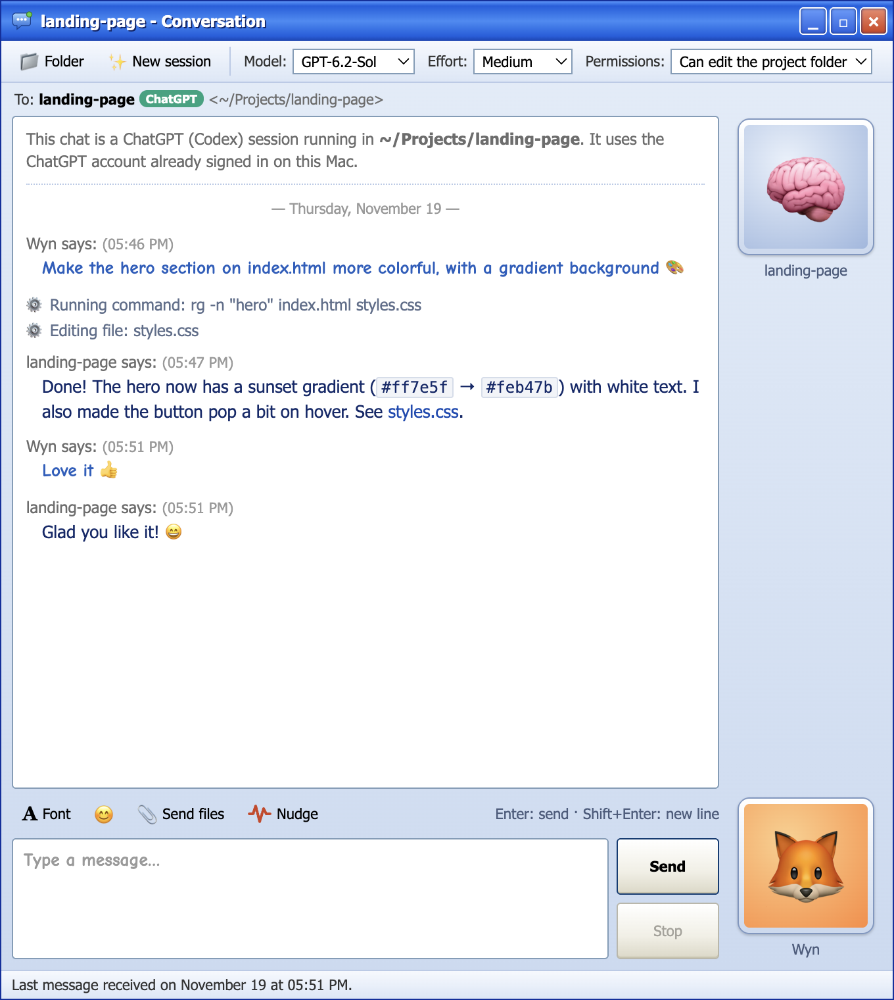
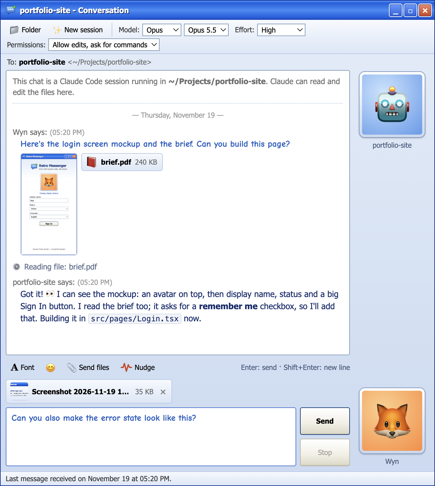
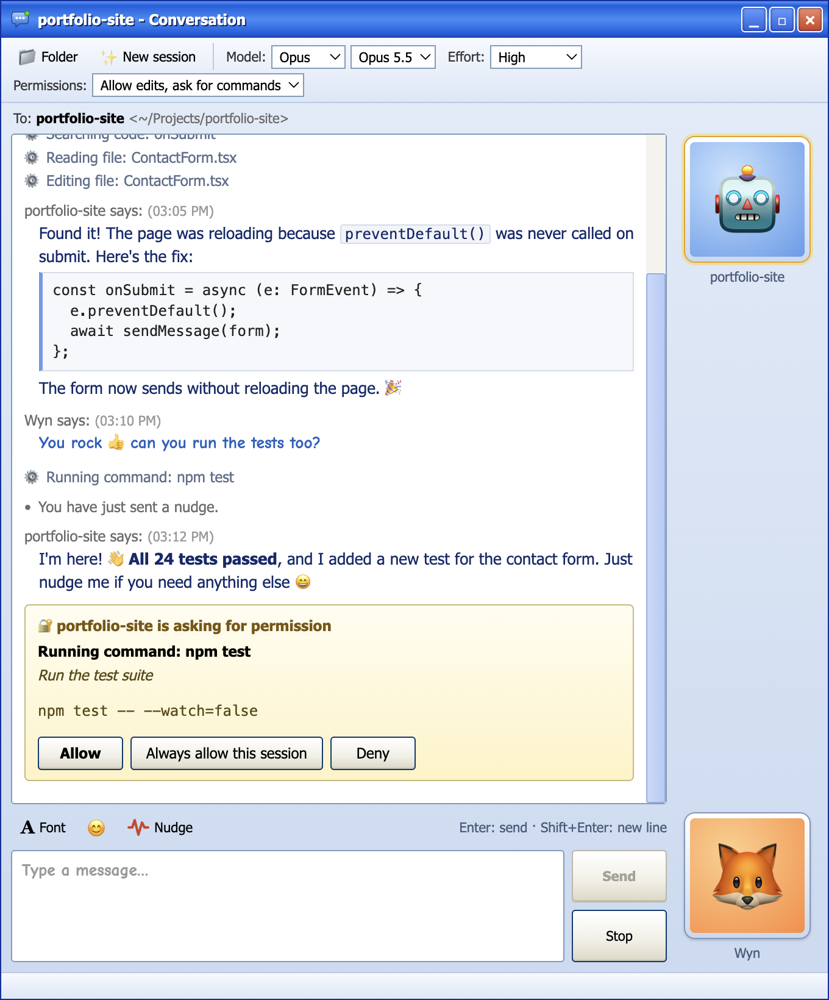
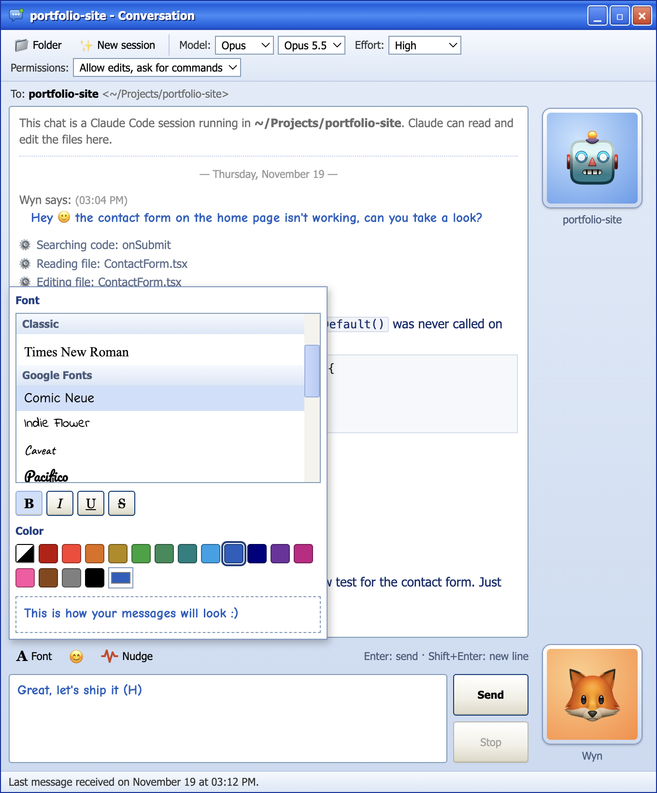
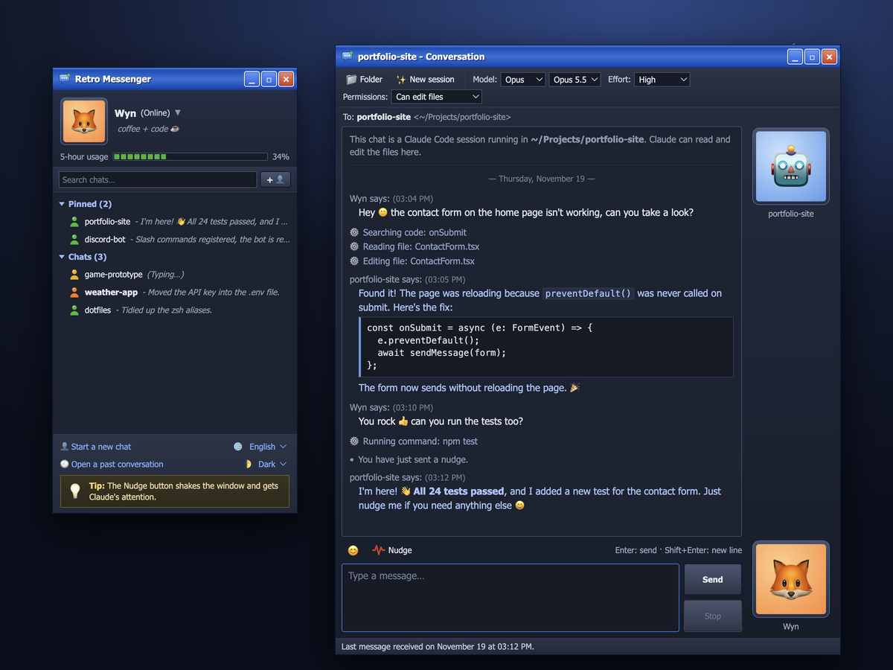

<div align="center">



# Retro Messenger

**Chat with Claude Code and ChatGPT like it's 2004.**

Contact list, display pictures, emoticons, nudges and "… says:" messages.<br>
Every conversation is a real Claude Code or ChatGPT (Codex) session running on your machine.

[](LICENSE)


[**⬇️ Download for macOS or Windows**](../../releases/latest) · [Features](#features) · [Install](#install) · [Run from source](#run-from-source) · [🇹🇷 Türkçe](README.tr.md)

<br>


</div>

---

## What is it?

Retro Messenger is a desktop app for using [Claude Code](https://code.claude.com) through an interface that brings back the instant messengers of the early 2000s.

It runs the `claude` command already installed on your computer, so your subscription, settings, plugins and MCP servers all work as usual. Claude reads and edits your files and runs commands. You just write to it the way you used to write to your friends.

> 💡 This project was inspired by **[CMSN](https://cmsn.app)**, the Mac app that first put Claude Code in a Messenger-style chat window. See [Credits](#credits).

## Features

<table>
<tr>
<td width="50%" valign="top">

### 👥 Contact list
Each chat is a "contact" that works in one project folder. The icon color shows its state:

- 🟢 idle
- 🟡 Claude is working ("Typing…")
- 🟠 unread reply

Pin, rename and search your chats. Set a personal message and a status (Online, Busy, Away).

</td>
<td width="50%"></td>
</tr>
<tr>
<td width="50%"></td>
<td width="50%" valign="top">

### 💬 Conversation window
- "… says:" messages, with replies that stream in live.
- Claude's actions (reading, editing, running commands) appear as grey lines.
- Code blocks are shown in their own boxes.
- Big display pictures on the side and a "… is typing a message" status bar.
- Classic shortcuts like `:)` `(Y)` `<3` `(H)` turn into emoji, and there's an emoticon grid too.

</td>
</tr>
<tr>
<td width="50%" valign="top">

### 📳 Nudge
The Nudge button shakes the window, plays a sound and tells Claude you want its attention. Claude answers with a short note on where things stand, which makes it the most fun way to check on a long task.

### 🔔 Notifications
When a reply arrives while the window is in the background:

- a sound plays,
- a toast pops up in the corner,
- the Dock icon bounces and shows a badge (on Windows, the taskbar button flashes and gets a red dot).

Set your status to "Busy" to silence all of it.

</td>
<td width="50%" align="center"><br><br></td>
</tr>
<tr>
<td width="50%"></td>
<td width="50%" valign="top">

### 🕘 Continue terminal conversations
Started something in the terminal with `claude`? Click **Open a past conversation** at the bottom of the contact list. You'll see every Claude Code conversation on your machine, with its title, folder and how long ago it was used. Pick one and it joins your contact list with its full history. Claude remembers everything, so you just keep talking.

</td>
</tr>
</table>

### 🤖 Claude and ChatGPT
Click **Start a new chat** and choose one of four:

- **Claude chat:** a regular Claude conversation, like the Claude app, with no project folder. It uses the Claude already signed in on your computer; Claude can search the web and read files you send.
- **ChatGPT chat:** the same for ChatGPT, using the ChatGPT account already signed in on your computer, with web search.
- **Claude Code** in a project folder, for coding.
- **ChatGPT (Codex)** in a project folder.

 ChatGPT chats use the Codex CLI that comes with the ChatGPT app (or one on your PATH) and the ChatGPT account already signed in on your computer, so there's no login in Retro Messenger. You pick the model from your account's list (GPT-6.2-Sol, Astra…), the reasoning effort, and how much it may touch: read only, edit the project folder, or full access. ChatGPT chats get a green badge in your contact list.



### 💾 Export a conversation
Click **💾 Export** in a conversation (or right-click it in the contact list and choose **Export…**) and save it as **Markdown** or a self-contained **HTML** page. The file has the whole conversation with times, your font colors, attachment names and a short header; the HTML adapts to light and dark mode.

### 📎 Send files and images
Click **📎 Send files**, drag files onto the conversation, or paste with ⌘V / Ctrl+V (screenshots too). They wait in a tray above the message box until you hit Send. Claude sees images right away, without opening them. For other files and folders it gets the path and opens them itself; if they're outside the project folder, you'll get a permission card first. In the history, images show as thumbnails and files as chips; click one to open it.



### 🔐 Permission prompts
When Claude wants to run a command, edit a file or start on a plan, a yellow card pops up in the conversation showing exactly what it wants to do: the command, the diff, or the plan. Choose **Allow**, **Always allow this session** or **Deny**. If the window is in the background you get a sound, a toast and a bouncing Dock icon (a flashing taskbar button on Windows), and the contact turns red in your list. Pick how much Claude may do on its own for each chat:

| Permissions | Claude asks before… |
| --- | --- |
| Ask before every change | any edit or command |
| Allow edits, ask for commands *(default)* | running commands |
| Plan mode | starting work; it plans first, you approve |
| Full access | nothing |



### 🎨 Your own font and color
Just like the old days: click **A Font** under the conversation and pick a font, **B** / *I* / U / S, and a color. Your messages, and even the box you type in, show up in that style. Choose from classics like Tahoma and Georgia or 14 Google Fonts, from Comic Neue to Press Start 2P. The fonts ship with the app, so they work offline. On the dark theme, dark colors are lifted automatically so they stay readable.



### 🌙 Dark mode
For late-night coding. Choose **Automatic** (follows your system), **Light** or **Dark** from the 🌓 menu at the bottom of the contact list.



### 🔊 Your own sounds
Every sound (app opens, app quits, sign in, sign out, new message, nudge) can be replaced: drop an `mp3`, `wav` or `ogg` named after the event (`nudge.mp3`, `login.wav`, …) into the `sounds` folder. **Settings → Sounds** shows what is custom and opens the folder. A file that is missing or broken just falls back to the built-in sound. The folder holds a `README.txt`, and [docs/SOUNDS.md](docs/SOUNDS.md) is the guide: file names, maximum length per sound (0.5 to 5 s), formats (MP3 128 kbps CBR / 44.1 kHz, WAV 16-bit 44.1 kHz) and size (2 MB).

### ⚙️ And also
- **Model, version and effort** for each chat. Pick a family (Fable, Opus, Sonnet, Haiku), then a version (for example Opus 5.5, 5 or 4.8) or "Latest". Effort runs from Low to Max; levels a model doesn't support are hidden.
- A **usage bar** that shows Claude's 5-hour usage limit.
- **Light and dark themes**, automatic by default.
- **English and Turkish** UI. It follows your system language, and you can switch it from the contact list.
- Chats and Claude sessions pick up where they left off after you restart the app.
- All sounds are generated in the app; there are no external audio files.

## Install

### Prebuilt app (macOS, Apple Silicon)

1. Download the `.dmg` from the [Releases](../../releases/latest) page.
2. Open it and drag **Retro Messenger** into **Applications**.
3. The app isn't notarized by Apple, so macOS warns you on first launch. Go to **System Settings → Privacy & Security** and click **Open Anyway**. Or run this in the terminal:
   ```bash
   xattr -dr com.apple.quarantine "/Applications/Retro Messenger.app"
   ```

### Prebuilt app (Windows, 64-bit)

1. Download `Retro-Messenger-Setup-X.Y.Z-x64.exe` from the [Releases](../../releases/latest) page.
2. Run it. It installs for your user only (no admin rights needed) and opens the app.
3. The installer isn't code-signed, so Windows SmartScreen may say "Windows protected your PC". Click **More info → Run anyway**.
4. **Updates are automatic.** The app checks GitHub for a newer release, downloads it in the background and installs it when you quit (or right away with **Settings → About → Restart and install**). You can turn this off in the same place.

**Requirement:** at least one of these, installed and signed in:
- [Claude Code](https://code.claude.com): run `claude` in the terminal once.
- The [ChatGPT app](https://chatgpt.com/download) (it includes Codex) or the [Codex CLI](https://github.com/openai/codex): sign in once.

### Run from source

```bash
git clone https://github.com/wynfirdolf/retro-messenger.git
cd retro-messenger
npm install
npm start
```

npm 11 may skip install scripts by default. If `npm start` says "Electron failed to install correctly", run `node node_modules/electron/install.js` once.

### Packaging

| Command | What it does |
| --- | --- |
| `npm run install:mac` | Builds the app, signs it locally and installs it to `/Applications` |
| `npm run dist:mac` | Produces a `.dmg` in `dist/` |
| `npm run dist:win` | Produces a Windows installer (`.exe`) in `dist/`; run it on Windows |

## How it works

```
┌──────────────┐   IPC   ┌───────────────┐   stdin/stdout (stream-json)   ┌──────────────┐
│  UI          │ ◄─────► │  Electron     │ ◄────────────────────────────► │  claude -p   │
│  (renderer/) │         │  main process │                                │  (one per    │
└──────────────┘         └───────────────┘                                │   chat)      │
                                                                          └──────────────┘
```

Each chat runs a `claude -p --input-format stream-json --output-format stream-json` process in the background. Replies stream in as they're written. The session ID is saved, so after a restart the conversation continues with `--resume`.

| File | Role |
| --- | --- |
| `main.js` | Windows, IPC, notifications, Dock badge / taskbar dot, nudge |
| `src/claude-session.js` | Runs the `claude` process and simplifies its event stream |
| `src/codex-session.js` | Runs `codex exec --json` for ChatGPT chats and maps its events to the same shape |
| `src/store.js` | Profile and chat history (`data.json` in the user data folder) |
| `src/export.js` | Turns a conversation into Markdown or HTML |
| `src/history.js` | Reads Claude Code's saved conversations (`~/.claude/projects`) so they can be imported |
| `renderer/i18n.js` | English and Turkish strings |
| `renderer/fonts/` | Message fonts from Google Fonts with their licenses (regenerate with `npm run fonts`) |
| `renderer/models.js` | Model families, versions and the effort levels each one supports |
| `renderer/` | UI: `list` contact list, `chat` conversation window, `toast` notification, `common` shared styles and helpers |

### Adding a language
Copy the `en` block in `renderer/i18n.js`, give it a new language code and translate the strings. The new language shows up in the language menu automatically.

## Known limitations

- ChatGPT (Codex) chats run in a sandbox instead of asking for permission, and replies arrive whole rather than streaming.
- Google Antigravity isn't supported: it has no command-line tool that works outside the Antigravity app.
- On macOS the app can't update itself: it isn't signed with an Apple Developer ID, so it only tells you a newer version exists (**Settings → About → Updates**) and opens the download page.
- Prebuilt releases are for Apple Silicon Macs and 64-bit Windows. Intel Macs can run it from source.

### 👍 Help us sync with claude.ai and chatgpt.com
Chats in Retro Messenger don't show up in the Claude or ChatGPT apps or websites, and your existing chats there can't be opened here. That's because the official command-line tools have no way to do it yet. We've asked for one:

- **Claude:** [anthropics/claude-code#13843](https://github.com/anthropics/claude-code/issues/13843)
- **ChatGPT:** [openai/codex#62754](https://github.com/openai/codex/issues/62754)

If you'd like this too, open the issues and add a 👍. The more people ask, the more likely it gets built.

## Roadmap

- [x] ~~*Windows build*~~
- [x] ~~*In-app permission prompts*~~
- [ ] Upload your own photo as a display picture
- [x] ~~*Font and color choice*~~
- [x] ~~*Export chat history*~~
- [x] ~~*Auto-update*~~ (Windows installs it; macOS points to the download)

Contributions are welcome. Open an issue or send a pull request.

## Credits

The idea comes from **[CMSN](https://cmsn.app)**, a Mac app that runs Claude Code inside an early-2000s Messenger-style window. If you'd like a polished, native version of this idea, check out CMSN and support its creator. 💙

Retro Messenger is a separate, open-source project written from scratch. It shares no code, artwork or sounds with CMSN.

## Fonts

The message fonts come from [Google Fonts](https://fonts.google.com) and are bundled under their own licenses (SIL Open Font License 1.1, and Apache 2.0 for Permanent Marker). Each license is in `renderer/fonts/licenses/`.

## Legal

Retro Messenger is an independent fan project. It is not affiliated with or endorsed by Microsoft or Anthropic. "MSN" and "Windows Live Messenger" are trademarks of Microsoft; "Claude" is a trademark of Anthropic. The logo, icons and sounds in this app were made from scratch for this project. Display pictures and emoticons use your system's emoji font.

## License

[MIT](LICENSE) © 2026 Wynfirdolf
