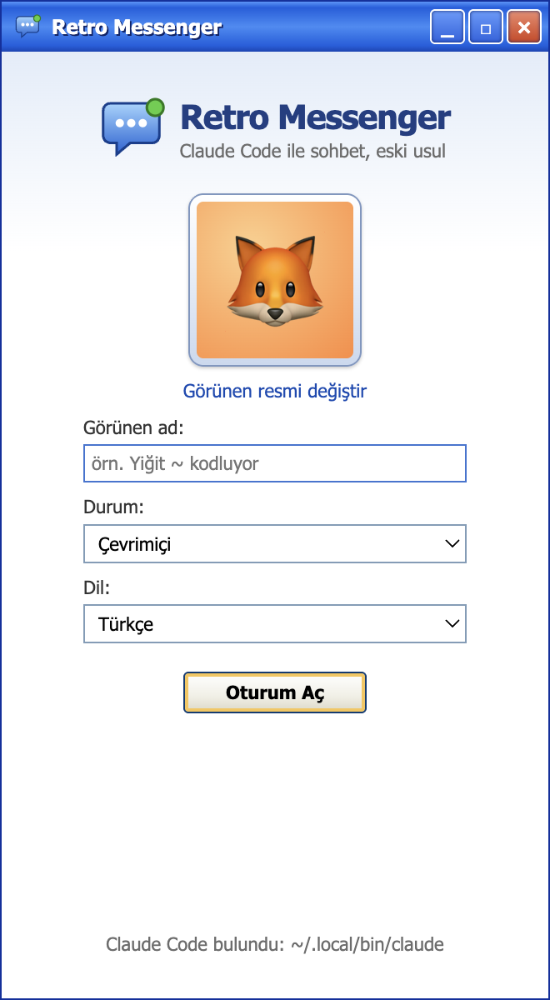

<div align="center">


# Retro Messenger

**Claude Code ile, 2004'teymişiz gibi sohbet edin.**

Kişi listesi, görünen resimler, ifadeler, titreşim ve "… diyor ki:" iletileri.<br>
Her sohbet, bilgisayarınızda çalışan gerçek bir Claude Code oturumu.

[](LICENSE)
-lightgrey)


[**⬇️ macOS için indir**](../../releases/latest) · [Özellikler](#özellikler) · [Kurulum](#kurulum) · [Kaynaktan çalıştırma](#kaynaktan-çalıştırma) · [🇬🇧 English](README.md)

<br>


</div>

---

## Nedir?

Retro Messenger, [Claude Code](https://code.claude.com)'u 2000'lerin anlık mesajlaşma programlarını hatırlatan bir arayüzde kullanmanızı sağlayan bir masaüstü uygulamasıdır.

Bilgisayarınızda kurulu olan `claude` komutunu çalıştırır. Bu yüzden aboneliğiniz, ayarlarınız, eklentileriniz ve MCP sunucularınız olduğu gibi kullanılır. Claude dosyalarınızı okur, düzenler ve komut çalıştırır; siz de ona eski arkadaşlarınıza yazar gibi yazarsınız.

## Özellikler

<table>
<tr>
<td width="50%" valign="top">

### 👥 Kişi listesi
Her sohbet bir "kişi" ve her biri bir proje klasöründe çalışır. Simgenin rengi o sohbetin durumunu gösterir:

- 🟢 boşta
- 🟡 Claude çalışıyor ("Yazıyor…")
- 🟠 okunmamış yanıt var

Sohbetleri sabitleyebilir, yeniden adlandırabilir ve arayabilirsiniz. Kişisel ileti ve durum seçimi (Çevrimiçi, Meşgul, Dışarıda) da var.

</td>
<td width="50%"></td>
</tr>
<tr>
<td width="50%"></td>
<td width="50%" valign="top">

### 💬 Sohbet penceresi
- "… diyor ki:" biçiminde iletiler ve canlı akan yanıtlar.
- Claude'un yaptığı işlemler (dosya okuma, düzenleme, komut çalıştırma) gri satırlarla görünür.
- Kod blokları ayrı kutularda gösterilir.
- İki tarafta büyük görünen resimler ve altta "… bir ileti yazıyor" durum çubuğu var.
- `:)` `(Y)` `<3` `(H)` gibi klasik kısayollar emojiye dönüşür. Ayrıca bir ifade ızgarası var.

</td>
</tr>
<tr>
<td width="50%" valign="top">

### 📳 Titreşim
Titreşim düğmesi pencereyi sallar, ses çalar ve Claude'a dikkatini çekmek istediğinizi iletir. Claude kısa bir cevapla ne durumda olduğunu söyler; uzun işlerde hızlıca durum sormanın en eğlenceli yolu.

### 🔔 Bildirimler
Pencere arka plandayken yanıt gelirse:

- ses çalar,
- sağ altta bildirim kutusu açılır,
- Dock simgesi zıplar ve rozet sayısı görünür.

Durumunuz "Meşgul" ise hepsi susar.

</td>
<td width="50%" align="center"><br><br></td>
</tr>
</table>

### ⚙️ Diğerleri
- Her sohbet için **model** (Opus, Sonnet, Haiku) ve **yetki** seçimi: yalnızca okuma, plan, dosya düzenleme veya tam yetki.
- Claude'un 5 saatlik kullanım sınırını gösteren **kullanım çubuğu**.
- **Türkçe ve İngilizce** arayüz. Sistem dilinize göre açılır; kişi listesinin altından değiştirebilirsiniz.
- Uygulama kapanıp açılınca sohbetler ve Claude oturumları kaldığı yerden devam eder.
- Seslerin hepsi uygulama içinde üretilir; harici ses dosyası yoktur.

## Kurulum

### Hazır sürüm (macOS, Apple Silicon)

1. [Releases](../../releases/latest) sayfasından `.dmg` dosyasını indirin.
2. Açın ve **Retro Messenger**'ı **Applications** klasörüne sürükleyin.
3. Uygulama Apple tarafından imzalanmadığı için ilk açılışta macOS uyarı verir. **Sistem Ayarları → Gizlilik ve Güvenlik** bölümüne gidip **Yine de Aç**'a tıklayın. Bunun yerine terminalde şu komutu da çalıştırabilirsiniz:
   ```bash
   xattr -dr com.apple.quarantine "/Applications/Retro Messenger.app"
   ```

**Gereksinim:** [Claude Code](https://code.claude.com) kurulu olmalı ve terminalde en az bir kez `claude` çalıştırılarak oturum açılmış olmalı.

### Kaynaktan çalıştırma

```bash
git clone https://github.com/wynfirdolf/retro-messenger.git
cd retro-messenger
npm install
npm start
```

npm 11 kurulum betiklerini varsayılan olarak çalıştırmayabilir. `npm start` "Electron failed to install correctly" derse bir kez `node node_modules/electron/install.js` çalıştırın.

### Paketleme

| Komut | Ne yapar |
| --- | --- |
| `npm run install:mac` | Uygulamayı derler, yerel imzayla imzalar ve `/Applications` klasörüne kurar |
| `npm run dist:mac` | `dist/` içine `.dmg` üretir |
| `npm run dist:win` | `dist/` içine Windows kurulum dosyası üretir |

## Nasıl çalışır?

```
┌──────────────┐   IPC   ┌───────────────┐   stdin/stdout (stream-json)   ┌──────────────┐
│  Arayüz      │ ◄─────► │  Electron     │ ◄────────────────────────────► │  claude -p   │
│  (renderer/) │         │  ana süreç    │                                │  (her sohbet │
└──────────────┘         └───────────────┘                                │   için bir)  │
                                                                          └──────────────┘
```

Her sohbet için arka planda `claude -p --input-format stream-json --output-format stream-json` süreci çalışır. Yanıtlar parça parça akar. Oturum kimliği saklandığı için uygulama yeniden açıldığında `--resume` ile kaldığı yerden devam edilir.

| Dosya | Görev |
| --- | --- |
| `main.js` | Pencereler, IPC, bildirimler, Dock rozeti, titreşim |
| `src/claude-session.js` | `claude` sürecini yönetir ve akan olayları sadeleştirir |
| `src/store.js` | Profil ve sohbet geçmişi (kullanıcı veri klasöründe `data.json`) |
| `renderer/i18n.js` | Türkçe ve İngilizce metinler |
| `renderer/` | Arayüz: `list` kişi listesi, `chat` sohbet penceresi, `toast` bildirim kutusu, `common` ortak stil ve yardımcılar |

### Yeni dil ekleme
`renderer/i18n.js` içindeki `en` bloğunu kopyalayın, yeni bir dil koduyla adlandırın ve metinleri çevirin. Yeni dil, dil menüsünde kendiliğinden görünür.

## Bilinen sınırlar

- `-p` modunda Claude izin soramaz. İzin gerektiren bir işlem reddedilirse sohbette bir not çıkar. Gerekirse üstteki **Yetki** ayarını değiştirin.
- Windows sürümü aynı kodla çalışacak şekilde yazıldı ama henüz test edilmedi.
- Hazır sürüm şimdilik yalnızca Apple Silicon Mac'ler içindir.

## Yol haritası

- [ ] Windows sürümü
- [ ] Uygulama içinden izin onayı (onay/ret penceresi)
- [ ] Görünen resim olarak kendi fotoğrafını yükleme
- [ ] Yazı tipi ve renk seçimi
- [ ] Sohbet geçmişini dışa aktarma

Katkılar memnuniyetle karşılanır. Bir issue açabilir veya pull request gönderebilirsiniz.

## Yasal not

Retro Messenger bağımsız bir hayran projesidir. Microsoft veya Anthropic ile bir bağlantısı yoktur ve onlar tarafından onaylanmamıştır. "MSN" ve "Windows Live Messenger" Microsoft'un, "Claude" Anthropic'in ticari markalarıdır. Uygulamadaki logo, simgeler ve sesler bu proje için sıfırdan yapıldı. Görünen resimler ve ifadeler sistemin emoji yazı tipini kullanır.

## Lisans

[MIT](LICENSE) © 2026 Wynfirdolf
