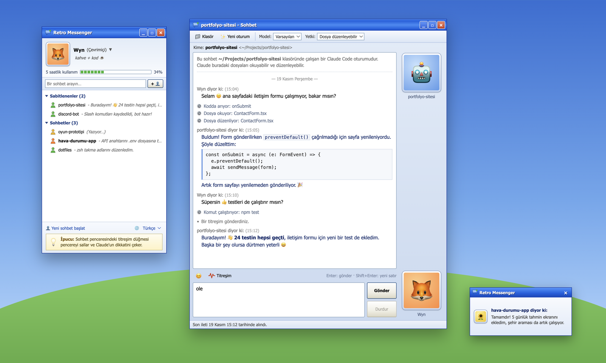
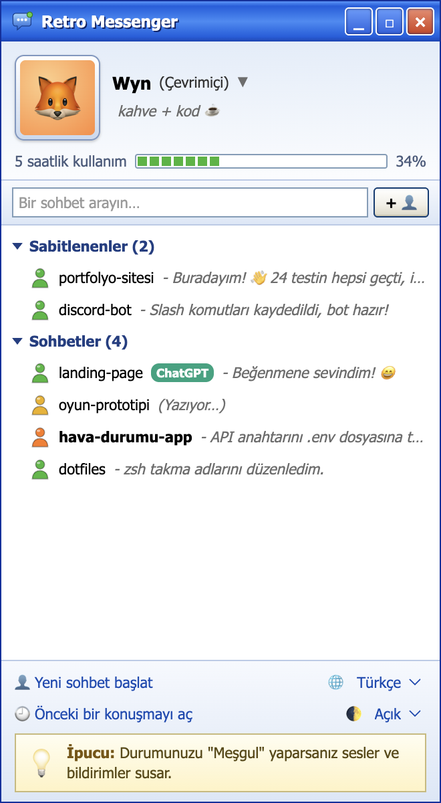
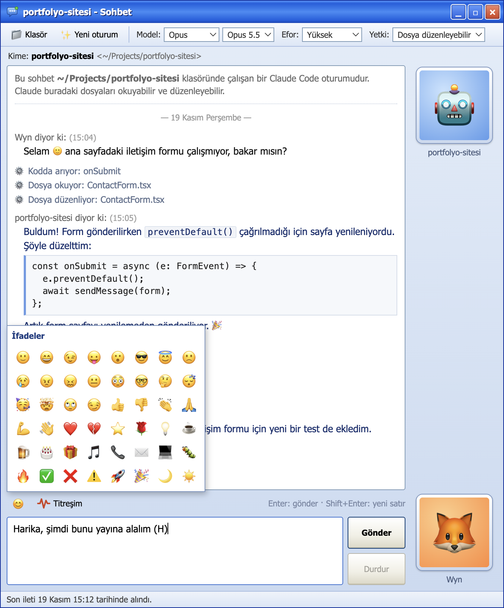
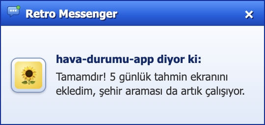
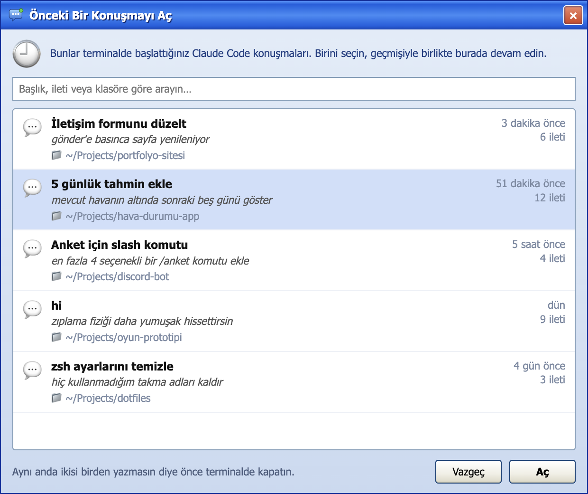
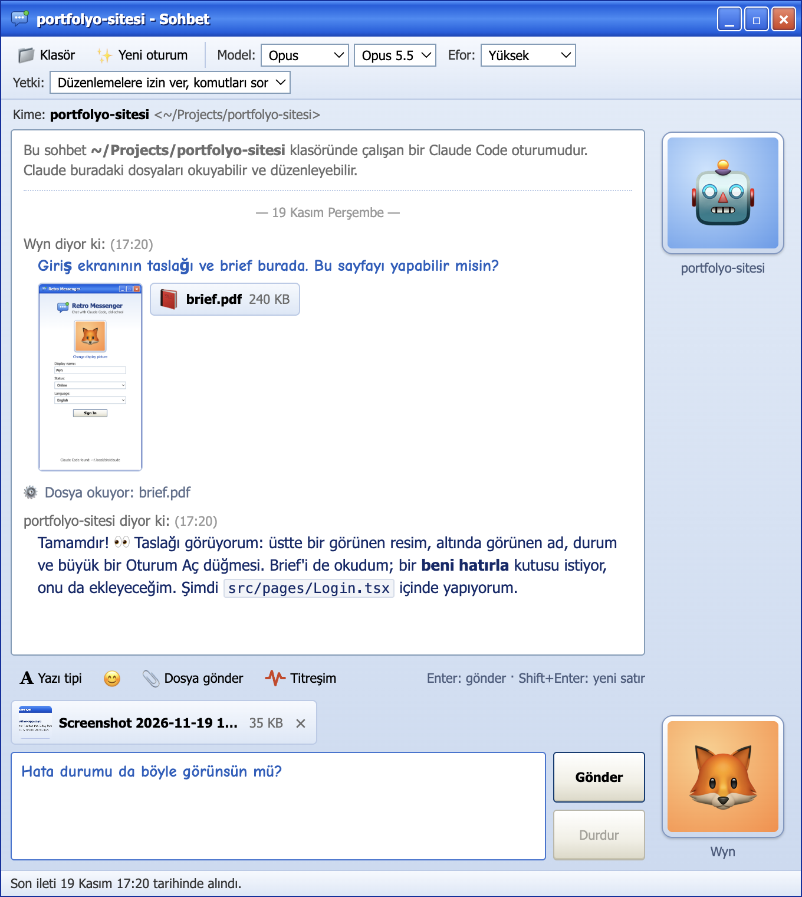
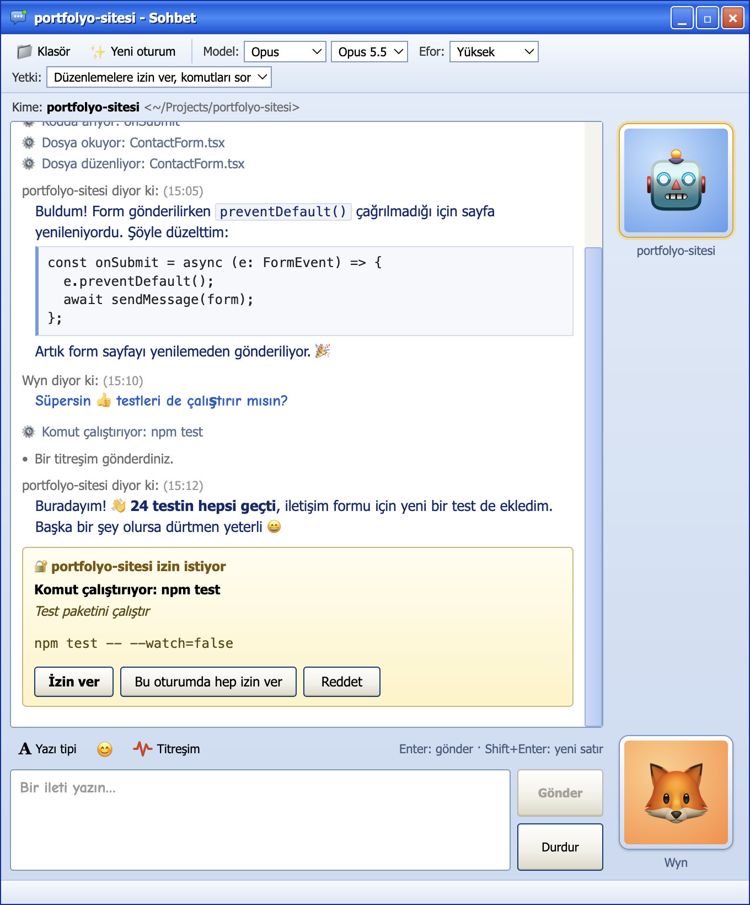
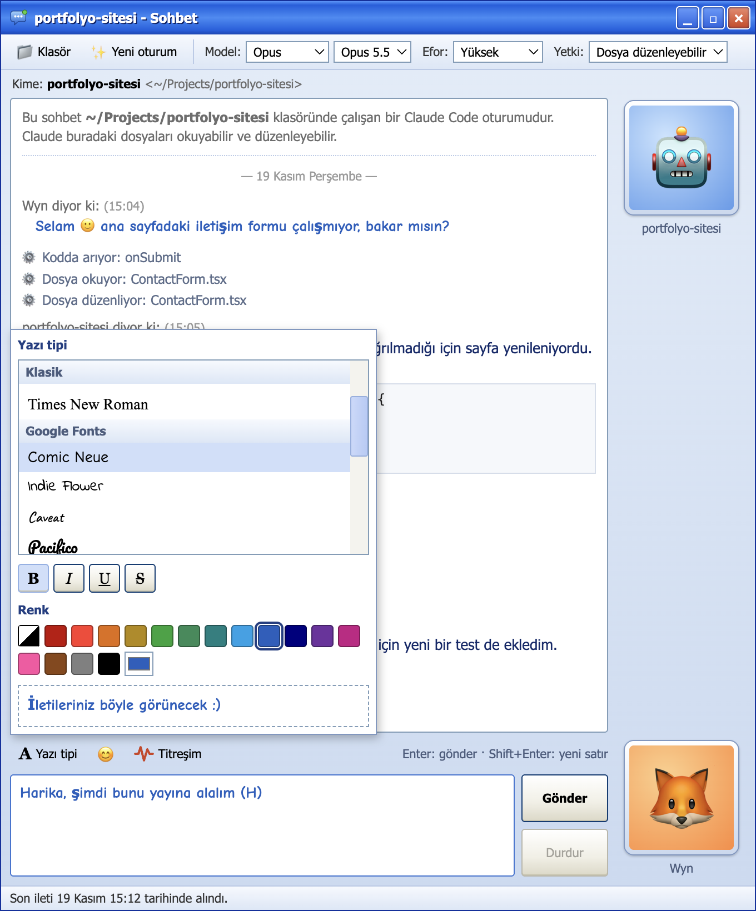
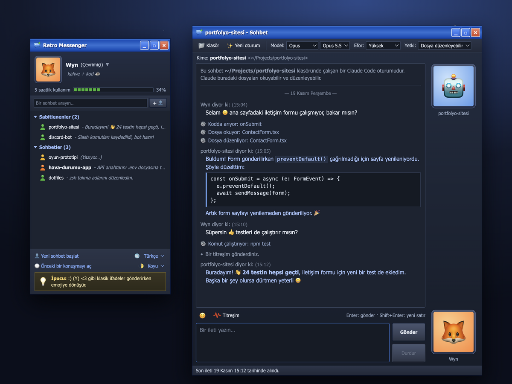

<div align="center">


# Retro Messenger

**Claude Code ile, 2004'teymişiz gibi sohbet edin.**

Kişi listesi, görünen resimler, ifadeler, titreşim ve "… diyor ki:" iletileri.<br>
Her sohbet, bilgisayarınızda çalışan gerçek bir Claude Code oturumu.

[](LICENSE)
-lightgrey)


[**⬇️ macOS için indir**](../../releases/latest) · [Özellikler](#özellikler) · [Kurulum](#kurulum) · [Kaynaktan çalıştırma](#kaynaktan-çalıştırma) · [🇬🇧 English](README.md)

<br>



</div>

---

## Nedir?

Retro Messenger, [Claude Code](https://code.claude.com)'u 2000'lerin anlık mesajlaşma programlarını hatırlatan bir arayüzde kullanmanızı sağlayan bir masaüstü uygulamasıdır.

Bilgisayarınızda kurulu olan `claude` komutunu çalıştırır. Bu yüzden aboneliğiniz, ayarlarınız, eklentileriniz ve MCP sunucularınız olduğu gibi kullanılır. Claude dosyalarınızı okur, düzenler ve komut çalıştırır; siz de ona eski arkadaşlarınıza yazar gibi yazarsınız.

> 💡 Bu proje, Claude Code'u ilk kez Messenger tarzı bir sohbet penceresine taşıyan Mac uygulaması **[CMSN](https://cmsn.app)**'den ilham aldı. Ayrıntılar için [Teşekkürler](#teşekkürler) bölümüne bakın.

## Özellikler

<table>
<tr>
<td width="50%" valign="top">

### 👥 Kişi listesi
Her sohbet bir "kişi" ve her biri bir proje klasöründe çalışır. Simgenin rengi o sohbetin durumunu gösterir:

- 🟢 boşta
- 🟡 Claude çalışıyor ("Yazıyor…")
- 🟠 okunmamış yanıt var

Sohbetleri sabitleyebilir, yeniden adlandırabilir ve arayabilirsiniz. Kişisel ileti ve durum seçimi (Çevrimiçi, Meşgul, Dışarıda) da var.

</td>
<td width="50%"></td>
</tr>
<tr>
<td width="50%"></td>
<td width="50%" valign="top">

### 💬 Sohbet penceresi
- "… diyor ki:" biçiminde iletiler ve canlı akan yanıtlar.
- Claude'un yaptığı işlemler (dosya okuma, düzenleme, komut çalıştırma) gri satırlarla görünür.
- Kod blokları ayrı kutularda gösterilir.
- İki tarafta büyük görünen resimler ve altta "… bir ileti yazıyor" durum çubuğu var.
- `:)` `(Y)` `<3` `(H)` gibi klasik kısayollar emojiye dönüşür. Ayrıca bir ifade ızgarası var.

</td>
</tr>
<tr>
<td width="50%" valign="top">

### 📳 Titreşim
Titreşim düğmesi pencereyi sallar, ses çalar ve Claude'a dikkatini çekmek istediğinizi iletir. Claude kısa bir cevapla ne durumda olduğunu söyler; uzun işlerde hızlıca durum sormanın en eğlenceli yolu.

### 🔔 Bildirimler
Pencere arka plandayken yanıt gelirse:

- ses çalar,
- sağ altta bildirim kutusu açılır,
- Dock simgesi zıplar ve rozet sayısı görünür.

Durumunuz "Meşgul" ise hepsi susar.

</td>
<td width="50%" align="center"><br><br></td>
</tr>
<tr>
<td width="50%"></td>
<td width="50%" valign="top">

### 🕘 Terminaldeki konuşmalara devam
Terminalde `claude` ile bir şey mi başlattınız? Kişi listesinin altındaki **Önceki bir konuşmayı aç** bağlantısına tıklayın. Bilgisayarınızdaki tüm Claude Code konuşmaları başlığı, klasörü ve en son ne zaman kullanıldığıyla listelenir. Birini seçtiğinizde tüm geçmişiyle kişi listenize eklenir. Claude her şeyi hatırlar, siz de kaldığınız yerden yazmaya devam edersiniz.

</td>
</tr>
</table>

### 📎 Dosya ve resim gönderme
**📎 Dosya gönder** düğmesine tıklayın, dosyaları sohbete sürükleyin ya da ⌘V ile yapıştırın (ekran görüntüleri dahil). Dosyalar, siz Gönder'e basana kadar mesaj kutusunun üstündeki tepside bekler. Claude resimleri açmasına gerek kalmadan hemen görür. Diğer dosya ve klasörlerin yolunu alır ve onları kendisi açar; proje klasörünün dışındaysa önce bir izin kartı çıkar. Geçmişte resimler küçük resim, dosyalar kart olarak görünür; tıklayınca açılırlar.



### 🔐 İzin onayı
Claude bir komut çalıştırmak, bir dosyayı düzenlemek ya da bir plana başlamak istediğinde sohbette sarı bir kart açılır. Kartta tam olarak ne yapmak istediği görünür: komut, değişiklik ya da plan. **İzin ver**, **Bu oturumda hep izin ver** veya **Reddet**'i seçersiniz. Pencere arka plandaysa ses çalar, bildirim kutusu açılır, Dock simgesi zıplar ve kişi listesinde o sohbet kırmızıya döner. Her sohbet için Claude'un ne kadarını kendi başına yapabileceğini seçebilirsiniz:

| Yetki | Claude şundan önce sorar… |
| --- | --- |
| Her değişiklikte sor | her düzenleme ve komut |
| Düzenlemelere izin ver, komutları sor *(varsayılan)* | komut çalıştırmak |
| Plan modu | çalışmaya başlamak; önce plan yapar, siz onaylarsınız |
| Tam yetki | hiçbir şey |



### 🎨 Kendi yazı tipin ve rengin
Tıpkı eskisi gibi: sohbetin altındaki **A Yazı tipi** düğmesine tıklayın; bir yazı tipi, **K** / *İ* / altı çizili / üstü çizili ve bir renk seçin. İletileriniz, hatta yazdığınız kutu bile o stilde görünür. Tahoma ve Georgia gibi klasiklerden ya da Comic Neue'dan Press Start 2P'ye 14 Google Fonts yazı tipinden seçebilirsiniz. Yazı tipleri uygulamayla birlikte gelir, internet olmadan da çalışır. Koyu temada koyu renkler okunabilsin diye otomatik olarak açılır.



### 🌙 Karanlık mod
Gece kod yazanlar için. Kişi listesinin altındaki 🌓 menüsünden **Otomatik** (sistemi takip eder), **Açık** veya **Koyu** seçebilirsiniz.



### ⚙️ Diğerleri
- Her sohbet için **model, sürüm ve efor** seçimi. Önce aileyi (Fable, Opus, Sonnet, Haiku), sonra sürümü (örneğin Opus 5.5, 5 veya 4.8) ya da "En yeni"yi seçin. Efor Düşük'ten Maksimum'a kadar ayarlanabilir; modelin desteklemediği seviyeler listede görünmez.
- Claude'un 5 saatlik kullanım sınırını gösteren **kullanım çubuğu**.
- **Açık ve koyu tema**, varsayılan olarak otomatik.
- **Türkçe ve İngilizce** arayüz. Sistem dilinize göre açılır; kişi listesinin altından değiştirebilirsiniz.
- Uygulama kapanıp açılınca sohbetler ve Claude oturumları kaldığı yerden devam eder.
- Seslerin hepsi uygulama içinde üretilir; harici ses dosyası yoktur.

## Kurulum

### Hazır sürüm (macOS, Apple Silicon)

1. [Releases](../../releases/latest) sayfasından `.dmg` dosyasını indirin.
2. Açın ve **Retro Messenger**'ı **Applications** klasörüne sürükleyin.
3. Uygulama Apple tarafından imzalanmadığı için ilk açılışta macOS uyarı verir. **Sistem Ayarları → Gizlilik ve Güvenlik** bölümüne gidip **Yine de Aç**'a tıklayın. Bunun yerine terminalde şu komutu da çalıştırabilirsiniz:
   ```bash
   xattr -dr com.apple.quarantine "/Applications/Retro Messenger.app"
   ```

**Gereksinim:** [Claude Code](https://code.claude.com) kurulu olmalı ve terminalde en az bir kez `claude` çalıştırılarak oturum açılmış olmalı.

### Kaynaktan çalıştırma

```bash
git clone https://github.com/wynfirdolf/retro-messenger.git
cd retro-messenger
npm install
npm start
```

npm 11 kurulum betiklerini varsayılan olarak çalıştırmayabilir. `npm start` "Electron failed to install correctly" derse bir kez `node node_modules/electron/install.js` çalıştırın.

### Paketleme

| Komut | Ne yapar |
| --- | --- |
| `npm run install:mac` | Uygulamayı derler, yerel imzayla imzalar ve `/Applications` klasörüne kurar |
| `npm run dist:mac` | `dist/` içine `.dmg` üretir |
| `npm run dist:win` | `dist/` içine Windows kurulum dosyası üretir |

## Nasıl çalışır?

```
┌──────────────┐   IPC   ┌───────────────┐   stdin/stdout (stream-json)   ┌──────────────┐
│  Arayüz      │ ◄─────► │  Electron     │ ◄────────────────────────────► │  claude -p   │
│  (renderer/) │         │  ana süreç    │                                │  (her sohbet │
└──────────────┘         └───────────────┘                                │   için bir)  │
                                                                          └──────────────┘
```

Her sohbet için arka planda `claude -p --input-format stream-json --output-format stream-json` süreci çalışır. Yanıtlar parça parça akar. Oturum kimliği saklandığı için uygulama yeniden açıldığında `--resume` ile kaldığı yerden devam edilir.

| Dosya | Görev |
| --- | --- |
| `main.js` | Pencereler, IPC, bildirimler, Dock rozeti, titreşim |
| `src/claude-session.js` | `claude` sürecini yönetir ve akan olayları sadeleştirir |
| `src/store.js` | Profil ve sohbet geçmişi (kullanıcı veri klasöründe `data.json`) |
| `src/history.js` | Claude Code'un kaydettiği konuşmaları (`~/.claude/projects`) içe aktarmak için okur |
| `renderer/i18n.js` | Türkçe ve İngilizce metinler |
| `renderer/fonts/` | Google Fonts'tan alınan ileti yazı tipleri ve lisansları (`npm run fonts` ile yeniden indirilir) |
| `renderer/models.js` | Model aileleri, sürümler ve her birinin desteklediği efor seviyeleri |
| `renderer/` | Arayüz: `list` kişi listesi, `chat` sohbet penceresi, `toast` bildirim kutusu, `common` ortak stil ve yardımcılar |

### Yeni dil ekleme
`renderer/i18n.js` içindeki `en` bloğunu kopyalayın, yeni bir dil koduyla adlandırın ve metinleri çevirin. Yeni dil, dil menüsünde kendiliğinden görünür.

## Bilinen sınırlar

- Windows sürümü aynı kodla çalışacak şekilde yazıldı ama henüz test edilmedi.
- Hazır sürüm şimdilik yalnızca Apple Silicon Mac'ler içindir.

## Yol haritası

- [ ] Windows sürümü
- [x] ~~*Uygulama içinden izin onayı*~~
- [ ] Görünen resim olarak kendi fotoğrafını yükleme
- [x] ~~*Yazı tipi ve renk seçimi*~~
- [ ] Sohbet geçmişini dışa aktarma

Katkılar memnuniyetle karşılanır. Bir issue açabilir veya pull request gönderebilirsiniz.

## Teşekkürler

Fikir, Claude Code'u 2000'lerin başındaki Messenger tarzı bir pencerede çalıştıran Mac uygulaması **[CMSN](https://cmsn.app)**'den geliyor. Bu fikrin özenle yapılmış, yerel bir sürümünü istiyorsanız CMSN'e göz atın ve yapımcısını destekleyin. 💙

Retro Messenger sıfırdan yazılmış ayrı ve açık kaynaklı bir projedir. CMSN ile ortak kodu, görseli veya sesi yoktur.

## Yazı tipleri

İleti yazı tipleri [Google Fonts](https://fonts.google.com)'tan alınmıştır ve kendi lisanslarıyla birlikte dağıtılır (SIL Open Font License 1.1; Permanent Marker için Apache 2.0). Lisans metinleri `renderer/fonts/licenses/` klasöründedir.

## Yasal not

Retro Messenger bağımsız bir hayran projesidir. Microsoft veya Anthropic ile bir bağlantısı yoktur ve onlar tarafından onaylanmamıştır. "MSN" ve "Windows Live Messenger" Microsoft'un, "Claude" Anthropic'in ticari markalarıdır. Uygulamadaki logo, simgeler ve sesler bu proje için sıfırdan yapıldı. Görünen resimler ve ifadeler sistemin emoji yazı tipini kullanır.

## Lisans

[MIT](LICENSE) © 2026 Wynfirdolf
